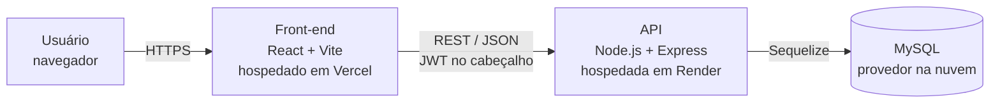
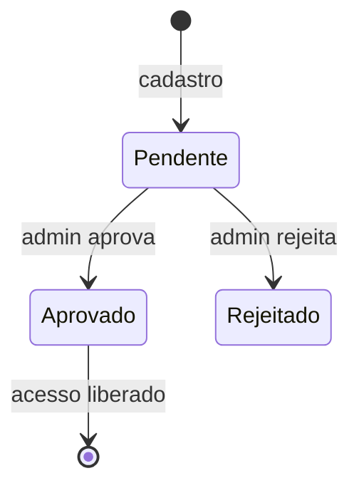

# Projeto Social Saúde Campinas

Plataforma web de apoio à ONG **Projeto Social Saúde Campinas**, que leva atendimento de saúde, escuta e acolhimento a pessoas em situação de rua e vulnerabilidade em Campinas.

Projeto desenvolvido pela equipe **DevCore** da **Fatec Itaquera** para o **Fatec Innovation Challenge (FIC) 2026**.

| | |
|---|---|
| **Aplicação publicada** | [https://URL-DO-FRONT] |
| **API** | [https://URL-DA-API]/api |
| **Documentação da API (Swagger)** | [https://URL-DA-API]/api-docs |
| **Vídeo de Defesa** | ver [`docs/originais/03_Video_Defesa/Link_Video.txt`](docs/originais/03_Video_Defesa/Link_Video.txt) |

---

## Sumário

1. [O problema](#o-problema)
2. [A solução](#a-solução)
3. [Equipe](#equipe)
4. [Tecnologias](#tecnologias)
5. [Arquitetura](#arquitetura)
6. [Estrutura do repositório](#estrutura-do-repositório)
7. [Como rodar localmente](#como-rodar-localmente)
8. [Perfis de acesso e fluxo de cadastro](#perfis-de-acesso-e-fluxo-de-cadastro)
9. [Testes](#testes)
10. [Deploy](#deploy)
11. [Documentação do projeto](#documentação-do-projeto)
12. [Uso de Inteligência Artificial](#uso-de-inteligência-artificial)

---

## O problema

O Projeto Social Saúde Campinas atua há 6 anos de forma **itinerante e sem sede fixa**, conduzido por estudantes de medicina e de outras áreas da saúde. As ações acontecem direto na rua, em mutirões.

Hoje a organização enfrenta dificuldades como:

- **Controle de medicamentos e insumos**: o estoque recebido por doação é controlado manualmente, o que dificulta saber o que está perto de vencer, o que está em falta e quem fez cada alteração.
- **Organização das ações**: a divulgação das datas dos mutirões e a confirmação de presença dos voluntários são feitas de forma dispersa.
- **Gestão de pessoas**: não há um cadastro central de voluntários e colaboradores, nem um processo claro de aprovação de quem entra na equipe.

## A solução

Uma aplicação web com uma área pública e uma área restrita para a equipe da ONG.

**Área pública**
- Apresentação da ONG, dos valores e da forma de atuação.
- Agenda das próximas ações.
- Página de doação, com a lista de medicamentos e insumos em falta.
- Página de contato.

**Área restrita**
- **Cadastro com aprovação**: a pessoa se cadastra como Colaborador ou Voluntário e só acessa o sistema depois que a administração aprova.
- **Estoque de medicamentos**: cadastro, validade, lote, local de armazenamento, alertas de vencimento e histórico de quem alterou cada item.
- **Eventos**: criação e edição das ações, com inscrição dos voluntários.
- **Painéis por perfil**: Administrador, Colaborador e Voluntário veem apenas o que é da sua função.

**Impacto esperado**

- [ex.: reduzir de 3 horas para 5 minutos o tempo de conferência do estoque antes de cada ação]
- [ex.: evitar o descarte de medicamentos vencidos com alertas de validade]
- [ex.: centralizar o cadastro de N voluntários ativos]

## Equipe

| Nome | Papel | Trilha concluída | GitHub |
|---|---|---|---|
| [Sofia Viana Vitorino Ornellas] | Agilista | Introdução a Metodologias Ágeis | [@vitorinosofia] |
| [Camila Alemi Dutra] | Desenvolvedor(a) Back-end | Desenvolvendo em Node.js | [@CamilaAlemi] |
| [Evelyn Aquiles Silva de França] | Desenvolvedor(a) Front-end | Desenvolvendo em React.js | [@myevvy] |
| [Martha Antonia Moreno Ribeiro] | DevOps | Introdução a Cloud | [@marthaaribeiro] |
| [Pedro Elias Paiva Fernandes] | Desenvolvedor(a) Front-end | Desenvolvendo em React.js | [@gowkiilu4] |

## Tecnologias

| Camada | Tecnologias |
|---|---|
| **Front-end** | React 19, Vite, TypeScript, TailwindCSS 4, react-router-dom, React Query, Axios, lucide-react |
| **Back-end** | Node.js, Express 5, Sequelize, JWT (jsonwebtoken), bcrypt, zod, helmet, express-rate-limit |
| **Banco de dados** | MySQL 8 |
| **Qualidade** | Jest e Supertest (back-end), ESLint, Swagger (swagger-ui-express) |
| **Deploy** | [Front: Vercel] · [API: Render] · [Banco: provedor MySQL] |

<!-- Mantenham esta tabela fiel ao que está nos package.json no momento da entrega. -->

## Arquitetura

O diagrama completo, com o código-fonte em Mermaid e a imagem exportada, está em [`docs/02_Arquitetura/`](docs/02_Arquitetura/).



<!-- Atualizem plataformas e componentes conforme o deploy real (Anexo IV, item 2.3). -->

## Estrutura do repositório

```
.
├── README.md                 Este arquivo
├── AGENTS.md                 Registro do uso de IA e instruções para agentes
├── frontend/                 Aplicação React (ver frontend/README.md)
├── backend/                  API Node.js + Express (ver backend/README.md)
└── docs/
    ├── originais/            Cópia INALTERADA do pacote da Submissão Institucional
    │   ├── 01_Proposta/                Proposta_Impacto.pdf
    │   ├── 02_Documentacao_Tecnica/
    │   │   ├── 01_Requisitos/          Documento_Requisitos.pdf
    │   │   ├── 02_Arquitetura/         Diagrama_Arquitetura.md e .png
    │   │   └── 03_Prototipos/          Prototipos_Interface.pdf
    │   └── 03_Video_Defesa/            Link_Video.txt
    ├── 01_Requisitos/        Documento_Requisitos_v2.pdf (versão atualizada)
    ├── 02_Arquitetura/       Diagrama_Arquitetura_v2.md e .png (versão atualizada)
    ├── 03_Prototipos/        Prototipos_Interface_v2.pdf (versão atualizada)
    ├── 04_Gerencia_de_Mudancas/  Changelog.pdf (o que mudou desde a submissão e por quê)
    └── 05_Apresentacao/      Slides_Apresentacao.pdf (Grande Final)
```

A pasta `docs/originais/` **não é alterada em hipótese alguma**. A evolução dos artefatos fica nas demais pastas de `docs/`.

## Como rodar localmente

### Pré-requisitos

- [Node.js](https://nodejs.org/) 22 LTS (mínimo 20.19)
- [MySQL](https://dev.mysql.com/downloads/) 8
- Git

### 1. Clonar o repositório

```bash
git clone https://github.com/[organizacao]/fic2026-[nome-da-fatec]-[nome-da-equipe].git
cd fic2026-[nome-da-fatec]-[nome-da-equipe]
```

### 2. Preparar o banco de dados

```sql
CREATE DATABASE ong_saude CHARACTER SET utf8mb4 COLLATE utf8mb4_unicode_ci;
```

As tabelas são criadas pelo back-end. Os detalhes estão em [`backend/README.md`](backend/README.md#banco-de-dados).

### 3. Subir o back-end

```bash
cd backend
npm install
cp .env.example .env        # no Windows: copy .env.example .env
# edite o .env com os dados do seu MySQL
npm run seed:admin          # cria o primeiro administrador
npm run dev                 # API em http://localhost:3000
```

Teste: `http://localhost:3000/api/health` deve responder `{"ok":true}`.

### 4. Subir o front-end

Em outro terminal:

```bash
cd frontend
npm install
cp .env.example .env        # no Windows: copy .env.example .env
npm run dev                 # aplicação em http://localhost:5173
```

Em desenvolvimento, o Vite redireciona as chamadas de `/api` para `http://localhost:3000`, então não é preciso configurar CORS localmente.

### 5. Acessar

| Endereço | O que é |
|---|---|
| http://localhost:5173 | Aplicação |
| http://localhost:3000/api-docs | Documentação interativa da API (Swagger) |

Entre com o administrador criado no passo 3 (e-mail e senha definidos em `ADMIN_EMAIL` e `ADMIN_SENHA` no `.env` do back-end).

## Perfis de acesso e fluxo de cadastro

| Perfil | O que pode fazer |
|---|---|
| **Administrador** | Aprova ou rejeita cadastros, gerencia colaboradores, estoque e eventos |
| **Colaborador** | Gerencia estoque de medicamentos e eventos, vê os inscritos nas ações |
| **Voluntário** | Vê a agenda, se inscreve nas ações e acompanha o próprio painel |

**Regra de cadastro**

1. A pessoa se cadastra na tela de cadastro e escolhe se é **Colaborador** ou **Voluntário**.
2. O cadastro fica com status **pendente**, e a pessoa ainda não consegue entrar no sistema.
3. O **Administrador** vê os dados e **aprova** ou **rejeita** a solicitação.
4. Só depois de aprovada a pessoa consegue fazer login.



A verificação é feita no back-end a cada requisição, então um usuário rejeitado ou desativado perde o acesso imediatamente.

## Testes

```bash
cd backend
npm test
```

Os testes automatizados cobrem as funcionalidades principais do back-end, incluindo o fluxo de cadastro, aprovação e login. Detalhes em [`backend/README.md`](backend/README.md#testes).

## Deploy

| Parte | Plataforma | URL |
|---|---|---|
| Front-end | [Vercel] | [https://URL-DO-FRONT] |
| API | [Render] | [https://URL-DA-API] |
| Banco de dados | [Provedor MySQL] | (privado) |

As variáveis de ambiente de produção estão descritas nos READMEs de [`frontend/`](frontend/README.md#variáveis-de-ambiente) e [`backend/`](backend/README.md#variáveis-de-ambiente).

**Versão avaliada:** a entrega final está congelada na tag `entrega-final`. O deploy publicado corresponde a esse ponto do histórico da branch `main`.

## Documentação do projeto

| Artefato | Versão da submissão | Versão atual |
|---|---|---|
| Proposta de Impacto | [`docs/originais/01_Proposta/`](docs/originais/01_Proposta/) | — |
| Documento de Requisitos | [`docs/originais/02_Documentacao_Tecnica/01_Requisitos/`](docs/originais/02_Documentacao_Tecnica/01_Requisitos/) | [`docs/01_Requisitos/`](docs/01_Requisitos/) |
| Diagrama de Arquitetura | [`docs/originais/02_Documentacao_Tecnica/02_Arquitetura/`](docs/originais/02_Documentacao_Tecnica/02_Arquitetura/) | [`docs/02_Arquitetura/`](docs/02_Arquitetura/) |
| Protótipos de Interface | [`docs/originais/02_Documentacao_Tecnica/03_Prototipos/`](docs/originais/02_Documentacao_Tecnica/03_Prototipos/) | [`docs/03_Prototipos/`](docs/03_Prototipos/) |
| Vídeo de Defesa | [`docs/originais/03_Video_Defesa/`](docs/originais/03_Video_Defesa/) | — |
| Gerência de Mudanças | — | [`docs/04_Gerencia_de_Mudancas/`](docs/04_Gerencia_de_Mudancas/) |
| Slides da Grande Final | — | [`docs/05_Apresentacao/`](docs/05_Apresentacao/) |

## Uso de Inteligência Artificial

Conforme a seção 11.2 do Regulamento Técnico, o uso de ferramentas de IA neste projeto está documentado em [`AGENTS.md`](AGENTS.md): quais ferramentas foram usadas, para quê, por quem e como o código gerado foi revisado pela equipe.